# Дмитрий Довиряк

**Fullstack-разработчик, тимлид и DevOps · основатель IT-команды [CLV-DIGITAL](https://clv-digital.tech)**

Ростов-на-Дону · **Русский** · [English](README.en.md)

---

### Коротко обо мне

Делаю продукты целиком: от разговора с заказчиком и архитектуры до бэкенда, интерфейса,
развёртывания и мониторинга. Руковожу командой CLV-DIGITAL, с которой мы пишем веб-сервисы,
Telegram-ботов, интеграции и ИИ-автоматизацию для бизнеса и регулярно выигрываем хакатоны.

- Бэкенд пишу в основном на **Python** (FastAPI, Django, aiogram), фронтенд на **React / Vue / Next.js**.
- Проектирую микросервисы с очередями, кэшем и наблюдаемостью, а не только отдельные API.
- Сам развёртываю и сопровождаю продакшн: Docker, Kubernetes, nginx, CI/CD, Prometheus и Grafana.

### Стек

<table>
  <tr>
    <td><b>Языки</b></td>
    <td></td>
  </tr>
  <tr>
    <td><b>Бэкенд</b></td>
    <td></td>
  </tr>
  <tr>
    <td><b>Фронтенд</b></td>
    <td></td>
  </tr>
  <tr>
    <td><b>Данные</b></td>
    <td></td>
  </tr>
  <tr>
    <td><b>DevOps</b></td>
    <td></td>
  </tr>
  <tr>
    <td><b>ИИ / ML</b></td>
    <td> &nbsp;RAG, LLM-интеграции, OCR, компьютерное зрение, спутниковые данные</td>
  </tr>
</table>

### Активность на GitHub

<picture>
  <source media="(prefers-color-scheme: dark)" srcset="assets/stats-ru-dark.svg">
  
</picture>

<picture>
  <source media="(prefers-color-scheme: dark)" srcset="assets/year-ru-dark.svg">
  
</picture>

<picture>
  <source media="(prefers-color-scheme: dark)" srcset="https://raw.githubusercontent.com/dimon0804/dimon0804/output/snake-dark.svg">
  
</picture>

Статистика учитывает и открытые, и закрытые репозитории и пересобирается сама каждые 6 часов.

### Сейчас в работе

<!--RECENT:START-->
Открытые репозитории, в которые я пушил за последние 30 дней

- [**peremena**](https://github.com/dimon0804/peremena) · сегодня «Перемена» — бот-помощник классного руководителя в MAX (Сферум): сборы согласий без ручного подсч…
- [**Docrux**](https://github.com/dimon0804/Docrux) · 22 дн. назад Докрукс — ИИ, который видит документ насквозь. Читает фото студенческой справки или заявления, за…
- и ещё 2 в закрытых репозиториях
<!--RECENT:END-->

### Открытые проекты

| Проект | О чём | Стек |
|---|---|---|
| [**Перемена**](https://github.com/dimon0804/peremena) | Бот-помощник классного руководителя в MAX: сборы согласий без ручного подсчёта, ответы родителям, полка материалов. [Демо](https://peremena.clv-digital.tech) | Python, FastAPI, Docker |
| [**Фенолог**](https://github.com/dimon0804/FENOLOG) | Мониторинг вегетации полей по спутниковым снимкам: восстанавливает ряды NDVI, находит периоды угнетения и объясняет причину. [Сервис](https://fenolog.clv-digital.tech) | Python, ДЗЗ, ML |
| [**Докрукс**](https://github.com/dimon0804/Docrux) | Читает фото студенческой справки или заявления, заполняет карточку полей и сверяет её с Положением со ссылкой на пункт. | FastAPI, React, Tesseract |
| [**Водополь**](https://github.com/dimon0804/VODOPOL) | Оценка ущерба от паводка по радарному снимку Sentinel-1 и подбор дополнительной съёмки в рамках бюджета. | Python, ДЗЗ |
| [**HeatRoute**](https://github.com/dimon0804/HeatRoute) | Строит до трёх вариантов подключения новых объектов к тепловой сети с маршрутами, диаметрами и стоимостью. «Лидеры цифровой трансформации» 2026 | Java, Spring Boot, React, MapLibre |
| [**FinTeen**](https://github.com/dimon0804/devHACK6) | Платформа и Telegram-бот, которые учат детей финансовой грамотности через игровые сценарии | FastAPI, Next.js, микросервисы |

### Коммерческие решения

Код закрыт. Решение можно взять по лицензии или с доработкой под вашу инфраструктуру,
демо и условия даю по запросу в [Telegram](https://t.me/dimon0804).

| Решение | Что делает | Стек |
|---|---|---|
| **ChurnRadar** | Анализатор риска оттока клиентов. Считает risk-score по каждому клиенту, объясняет причины и показывает, сколько денег под угрозой. Есть список «кому позвонить», сценарии «что если» и оповещения. 2 место на хакатоне РНД в ДГТУ, кейс Aéza | Python, микросервисы, NATS, Kubernetes, Prometheus |

### Достижения

| Результат | Где и когда |
|---|---|
| **I место** | КосмоХакатон, окружной этап ЮФО и СКФО, кейс «Мониторинг вегетационной динамики» · 2026 |
| **2 место по региону** | «Идея фикс» с проектом «Перемена» · 2026 |
| **Диплом I степени** | devHack #6, кейс банка «Центр-инвест» · 2026 |
| **II место** | DDoS-Guard Хакатон · 2025 |
| **Победитель** | «ИНДУСТРИЯ 2025», IV региональный хакатон Ростовской области · 2025 |

 
Открыт к коммерческим проектам и командной разработке. Проще всего написать в <a href="https://t.me/dimon0804">Telegram</a>.

